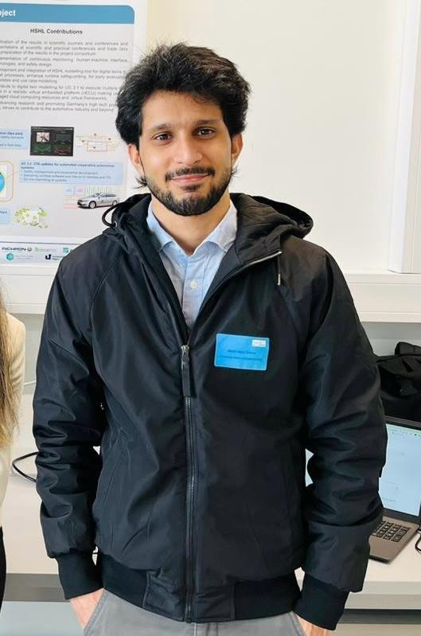

<!-- Profile layout saved 18 October 2026. Editing and restore help: docs/PROFILE_GUIDE.md -->
<table>
<tr>
<td valign="middle" width="72%">

<strong>HARDWARE VALIDATION · EMBEDDED SYSTEMS · POWER ELECTRONICS</strong>

<h1>Moiz Zaheer Malik</h1>
<h2>Hardware. Tested. Trusted.</h2>

Electronic Engineering graduate working in <strong>Systems Engineering at Infineon Technologies AG</strong>.

I connect embedded software, electronics and practical testing — from EtherCAT control and HIL validation to PCB design and working prototypes.

<strong>Lippstadt, Germany · Open to relocation</strong>

</td>
<td width="28%" align="center" valign="middle"></td>
</tr>
</table>

<a href="#about">About</a> · <a href="#work-experience">Experience</a> · <a href="#professional-feedback">Feedback</a> · <a href="#projects-to-start-with">Projects</a> · <a href="#research">Research</a> · <a href="#skills">Skills</a> · <a href="#education">Education</a>

## About

I have 2+ years of practical engineering experience across Infineon, microsynetics and university research. My work combines semiconductor testing, embedded control, hardware debugging and technical documentation. I enjoy turning an engineering requirement into something I can build, measure and explain.

| Bachelor thesis | B.Eng. final grade | Degree completed | Research |
| :---: | :---: | :---: | :---: |
| **1.0** | **2.0** | **210 ECTS** | **ETFA 2026 accepted full paper** |

## Work experience

### Infineon Technologies AG · Warstein, Germany

**Working Student · Systems Engineering** · August 2026–present

- Support power semiconductor module validation, including Double Pulse Test preparation and execution.
- Assist with current and temperature testing, measurement setups, result analysis and documentation.

**Working Student · Product Application Engineering** · March–July 2026

- Implemented EtherCAT slave functionality through PLC and microcontroller programming.
- Configured the software/analysis environment and tested solutions in a Hardware-in-the-Loop setup.

**Bachelor Thesis Student · Product Application Engineering** · November 2025–February 2026

- Developed and validated an EtherCAT slave on TI C2000 F28P65x with TwinCAT 3 and Beckhoff Slave Stack Code.
- Integrated PDOs, GPIO, PWM, ADC and PLECS-generated control code; checked behaviour using RT Box, TwinCAT Scope and PicoScope. **Thesis grade: 1.0.**

### Hochschule Hamm-Lippstadt · Lippstadt, Germany

**Student Assistant · DevOpsSafe research project** · April 2025–April 2026

- Supported RISC-V/QEMU virtual controller environments and CARLA telemetry exchange over UDP/JSON.
- Worked with driving scenarios, fault injection, supervisory monitoring and CSV/JSON test logs.
- Contributed to research on the validation of virtualized automotive controllers.

### microsynetics GmbH · Soest, Germany

**Working Student · Embedded Hardware** · February–July 2025  
**Intern · Embedded Hardware** · August 2024–January 2025

- Tested smart-wearable prototypes, development boards, sensors and PCBs; supported hardware debugging and integration.
- Designed and checked enclosures and component fit in Fusion 360; supported 3D printing and thermal simulation.
- Researched components and prepared BOMs, test documentation and Excel/VBA tools.

## Professional feedback

> “Mr. Malik worked independently, reliably and efficiently, and found good solutions.”  
> **Infineon Technologies AG** · Official employment reference

> “consistently exceeded expectations and delivered outstanding results.”  
> **Michael Hummels, CTO · microsynetics GmbH** · Excerpt from employment reference

> “very good studies and research capabilities”  
> **Prof. Dr. Achim Rettberg · Hochschule Hamm-Lippstadt** · Letter of recommendation

Reference documents are available on request.

## Projects to start with

Three selected examples. [Explore all 15 projects →](portfolio/README.md)

<table>
<tr>
<td width="38%" valign="top"></td>
<td valign="top"><h3>EtherCAT and HIL verification</h3>
<strong>Bachelor thesis · Grade 1.0</strong>

Integrated an EtherCAT slave on TI C2000 with TwinCAT 3 and PLECS / RT Box.

<strong>Result:</strong> Verified cyclic PDO exchange, digital and analogue feedback, PWM and ADC behaviour.

TI C2000 · EtherCAT · TwinCAT 3 · PLECS
<a href="https://github.com/moizZM/moizZM/blob/main/portfolio/projects/ethercat-hil.md"><strong>View project details →</strong></a></td>
</tr>
<tr>
<td width="38%" valign="top"></td>
<td valign="top"><h3>Automotive controller testing</h3>
<strong>DevOpsSafe research contribution</strong>

Supported a RISC-V / QEMU virtual controller exchanging UDP/JSON telemetry with CARLA.

<strong>Result:</strong> Examined controller behaviour under dropped, delayed, modified and stale messages using test logs.

CARLA · RISC-V · QEMU · Python · UDP
<a href="https://github.com/moizZM/moizZM/blob/main/portfolio/projects/carla-riscv.md"><strong>View project details →</strong></a></td>
</tr>
<tr>
<td width="38%" valign="top"></td>
<td valign="top"><h3>Custom FPGA board design</h3>
<strong>University team project · PCB design</strong>

Owned the KiCad development-board design around a Lattice iCE40UP5K FPGA.

<strong>Result:</strong> Completed schematic/layout checks and prepared Gerber and drill files.

KiCad · iCE40UP5K · USB · UART · SPI
<a href="https://github.com/moizZM/moizZM/blob/main/portfolio/projects/fpga-board.md"><strong>View project details →</strong></a></td>
</tr>
</table>

**Also building:** [Jetson Nano restricted-area monitor](portfolio/projects/restricted-area-monitor.md) — person detection, zone-entry alerts, Node-RED and event evidence.

**More engineering work:** [PCB design](portfolio/README.md#pcb-design) · [Wearable hardware and CAD](portfolio/README.md#wearable-hardware-and-mechanical-design) · [Robotics and IoT](portfolio/README.md#robotics-iot-and-systems-modelling)

## Research

**Towards Safety and Validation of Virtualized Automotive Controllers via a Modular Testbed with Supervisory Monitoring and Standards-Aligned Fault Injection**

Co-author · Accepted full paper, CAIESS workshop at ETFA 2026.

My supporting research work included the RISC-V/QEMU controller environment, CARLA telemetry over UDP, controller scripts and test logging. [Explore the related project →](portfolio/projects/carla-riscv.md)

## Skills

| Area | Tools and practical work |
| --- | --- |
| Embedded control | C/C++, Python, TI C2000, STM32, Arduino, ESP32, AVR, Raspberry Pi, Jetson Nano |
| Validation and measurement | EtherCAT, TwinCAT 3, Beckhoff SSC, PLECS, RT Box HIL, PicoScope, oscilloscopes, multimeters |
| PCB and digital design | KiCad, Altium Designer, schematic/layout, ERC/DRC, manufacturing files, VHDL, FPGA |
| Simulation and communication | CARLA, RISC-V, QEMU, Linux, UDP/JSON, MQTT, fault injection, test logs |
| Mechanical development | Fusion 360, SolidWorks, ANSYS Workbench, 3D printing, assembly and fit checks |
| Engineering workflow | Git, technical documentation, Confluence, Excel/VBA, component and datasheet research |

## Education

**M.Eng. Embedded Systems Engineering** · Fachhochschule Dortmund  
Started September 2026 · Planned completion August 2029

**B.Eng. Electronic Engineering** · Hochschule Hamm-Lippstadt  
September 2022–July 2026 · Final grade **2.0**, thesis **1.0**, project work **1.3**, practical semester **1.3**, **210 ECTS**

**Additional training:** PLECS and RT Box workshop at Infineon; *Concepts for Small Antennas and How to Integrate*, cetecom advanced, January 2025.

## Contact

Interested in hardware validation, embedded systems, PCB development or an engineering project? [Email me](mailto:moizzaheermalik@gmail.com) or [connect on LinkedIn](https://www.linkedin.com/in/moiz-zaheer-malik-473ab1298).

**Email:** moizzaheermalik@gmail.com · **Languages:** English (fluent), German (basic)

Portfolio editing and previous version

[Editing and restore guide](docs/PROFILE_GUIDE.md) · [Previous profile](docs/README-before-2026-10-18.md)

