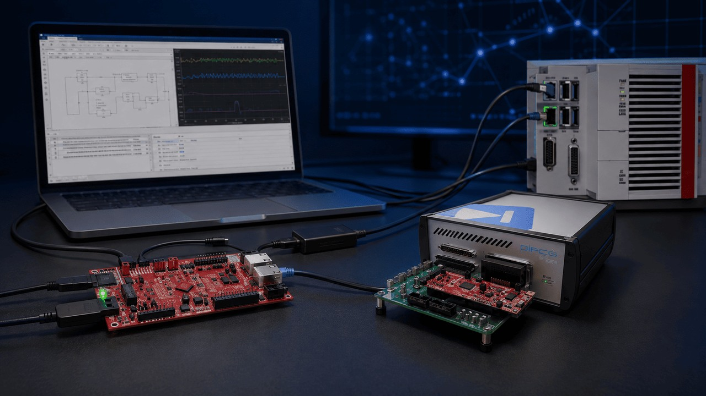
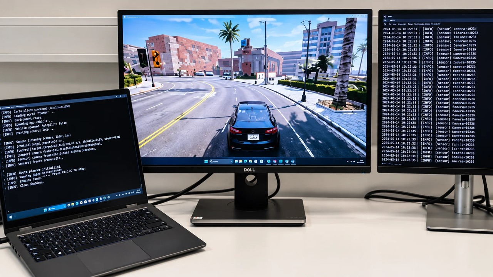
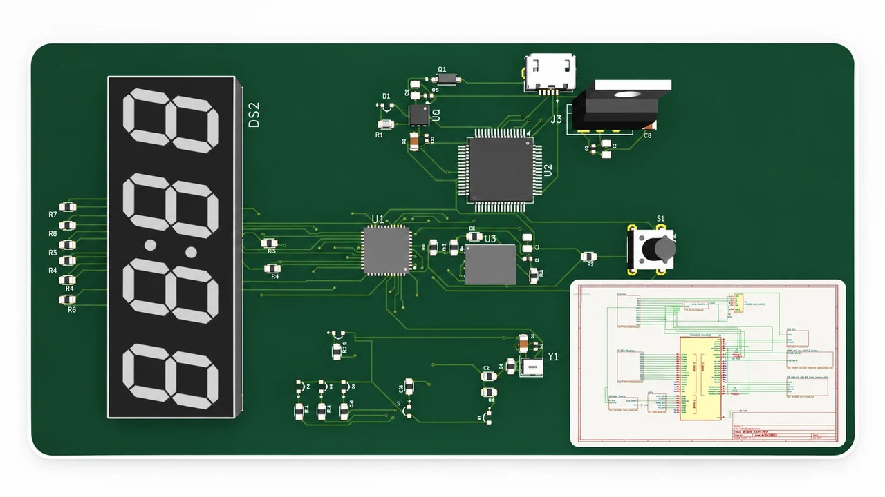
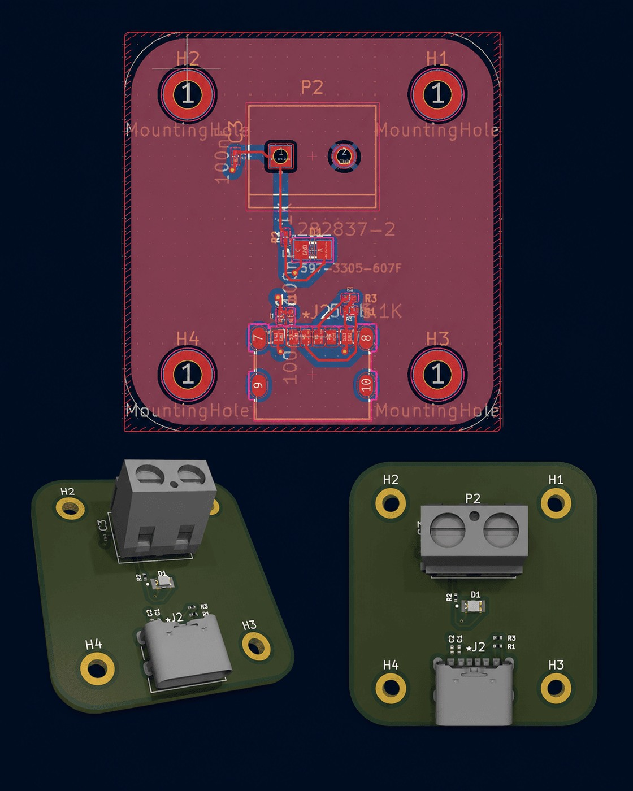
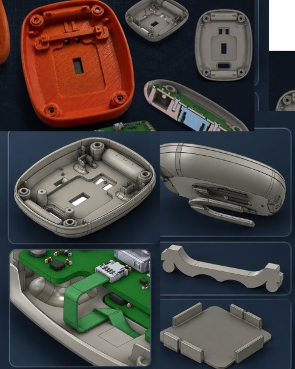
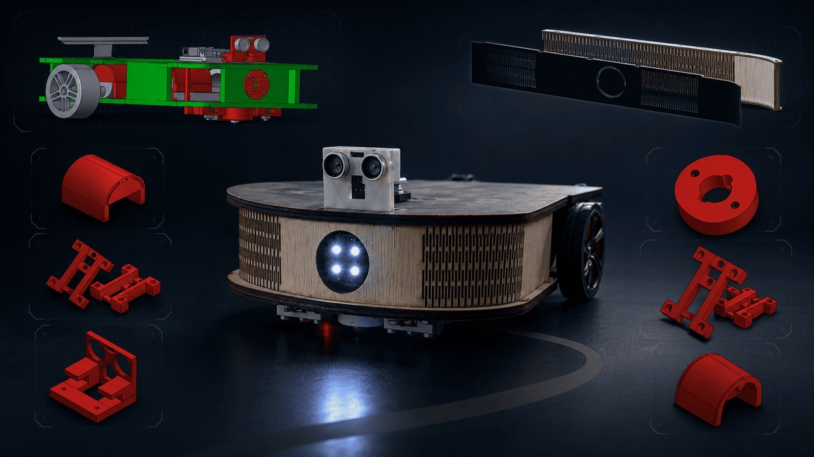
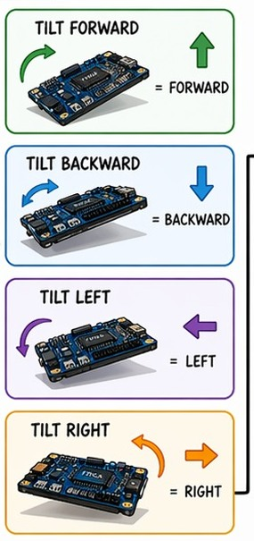
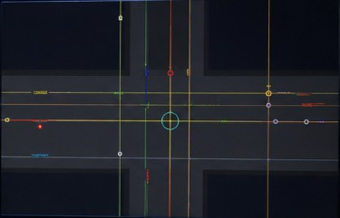

# Engineering project portfolio

[← Back to my profile](../README.md)

A closer look at 15 projects across embedded control, hardware validation, PCB design, robotics and prototyping. Each overview separates the engineering problem, my contribution and the result.

[Embedded systems](#embedded-systems-validation-and-ai) · [PCB design](#pcb-design) · [Wearables](#wearable-hardware-and-mechanical-design) · [Robotics and IoT](#robotics-iot-and-systems-modelling)

## Embedded systems, validation and AI

### EtherCAT Slave & HIL Verification for Power Stage Control

**Completed**

Developed an EtherCAT slave on TI C2000 with TwinCAT 3. Verified digital and analogue feedback through PLECS and RT Box test setups.

**My contribution:** Configured PDOs, object-dictionary and ESI data; integrated firmware, GPIO, PWM, ADC and PLECS-generated control code; debugged communication and timing issues.

**Result:** Tested cyclic PDO exchange, LEDs, digital and analogue feedback, PWM and ADC behaviour using TwinCAT Scope and PicoScope.

[View project details →](projects/ethercat-hil.md)

---

### CARLA & RISC-V UDP Controller Testbed

**Completed research work**

CARLA generated vehicle telemetry while a RISC-V Ubuntu virtual machine acted as a virtual embedded controller using UDP and JSON.

**My contribution:** Supported traffic-light, pedestrian, ACC and CACC scenarios plus dropped, delayed, modified and stale messages.

**Result:** Used supervisory monitoring and CSV/JSON logs to inspect controller and communication behaviour.

[View project details →](projects/carla-riscv.md)

---

### Jetson Nano Restricted Area Monitor

**In Progress**

Jetson based system that detects restricted area entry, triggers alerts, and updates a live Node RED dashboard.

**My contribution:** System integration, restricted zone logic, Node RED dashboard, testing, troubleshooting, and documentation.

**Result:** Tested with single and multiple people. The system correctly detected entry, updated counts, triggered alerts, and saved evidence.

[View project details →](projects/restricted-area-monitor.md)

---

### Jetson Nano Object Detection & Monitoring

**Research contribution**

Worked with Jetson Nano, YOLOv5, TensorRT, video streaming and performance monitoring.

**My contribution:** Supported integration and validation activities proportional to my student-assistant role.

**Result:** Used monitoring information to inspect system performance during testing.

[View project details →](projects/jetson-research.md)

---

## PCB design

### Custom FPGA Development Board for an 8-Bit Harvard CPU

**Completed university project**

Designed a development board with USB, UART, SPI flash, voltage regulation, clock, reset, LEDs and a four-digit seven-segment display.

**My contribution:** Owned the PCB design: hierarchical schematics, component selection, layout, manual routing, ERC, DRC and manufacturing files. Teammates developed the CPU logic in VHDL.

**Result:** Completed ERC and DRC checks and prepared Gerber and drill outputs. This result describes design and manufacturing preparation; physical board testing is not claimed here.

[View project details →](projects/fpga-board.md)

---

### Binary Watch PCB

**Manufactured**

Designed the schematic and compact board layout with careful LED and component placement.

**My contribution:** Designed the schematic and compact PCB layout, selected and placed components, completed ERC and DRC, and prepared manufacturing outputs.

**Result:** A physical PCB was manufactured through JLCPCB.

[View project details →](projects/binary-watch.md)

---

### USB-C Power Supply PCB

**Completed design**

Created the schematic and PCB with CC resistors, decoupling, power LED, output header and mounting holes.

**My contribution:** Prepared the layout, checked the 3D board view and generated manufacturing outputs.

**Result:** Completed ERC and DRC and prepared Gerber, drill, BOM and pick-and-place files.

[View project details →](projects/usb-c-board.md)

---

### ATtiny Microcontroller Board

**Ongoing**

Prepared the schematic and PCB layout for the microcontroller, voltage regulation, reset, clock and headers.

**My contribution:** Developed the current schematic and board layout.

**Result:** Final checks and manufacturing files are still pending.

[View project details →](projects/attiny-board.md)

---

## Wearable hardware and mechanical design

### Internship at microsynetics

**Completed**

Supported smart wearable testing, PCB debugging and prototype development at microsynetics. Combined laboratory work with CAD, component research and documentation.

**My contribution:** Worked across several parts of embedded hardware product development. Designed and modified mechanical parts, supported PCB and component work, researched connectors and sensors, performed thermal simulations, helped with prototype sealing checks, inspected and debugged PCBs, supported soldering and hardware rework, tested cellular modules and prepared technical documentation.

**Result:** Used CAD fit checks, 3D printed prototypes, thermal simulations and laboratory measurements to check the hardware. Compared working and faulty PCBs, performed continuity and voltage checks, inspected signals with oscilloscopes and supported step by step hardware debugging. The work provided practical experience with complete embedded hardware product development.

[View project details →](projects/wearable-hardware.md)

---

### Smart Wearable 3D Modelling & Mechanical Integration

**Completed**

Designed wearable housings and checked PCB, battery and connector fit. Used CAD and printed prototypes to check assembly.

**My contribution:** Designed and modified housing parts in Fusion 360. Created cutouts for sensors and connector access. Worked with curved surfaces and internal geometry. Designed PCB and battery holder concepts. Checked flexible PCB placement and internal component fit. Used section views to inspect the complete assembly. Supported 3D printing and prototype assembly checks.

**Result:** Checked the complete assembly using CAD section views and physical prototype fit checks. Verified PCB, battery, connector and sensor placement inside the housing. Supported 3D printed prototype assembly and checked the mechanical fit of the parts.

[View project details →](projects/wearable-mechanical-design.md)

---

## Robotics, IoT and systems modelling

### Autonomous Line-Following Car

**Completed university project**

Combined Arduino control with IR, ultrasonic and colour sensors, DC motors and a motor driver.

**My contribution:** Designed the chassis, holders and covers in SolidWorks and supported assembly and fit checks.

**Result:** Tested line following, obstacle detection, colour detection and motor movement.

[View project details →](projects/line-following-car.md)

---

### FPGA Tilt-Controlled Robot

**Completed university project**

An ADXL362 accelerometer and FPGA produced tilt data while an ESP32 controlled motors through PWM.

**My contribution:** Created seven-segment display IP and supported the ESP32 motor setup, IR sensors, communication and integration.

**Result:** Integrated tilt sensing, wireless communication, motor control and obstacle sensing.

[View project details →](projects/fpga-tilt-robot.md)

---

### Solar Tracking IoT System

**Completed university project**

LDR sensors and an Arduino controlled a servo while a Raspberry Pi acted as an MQTT broker.

**My contribution:** Built the Arduino logic and hardware setup, installed Mosquitto and supported assembly.

**Result:** The prototype changed panel orientation from sensor data and accepted remote MQTT commands.

[View project details →](projects/solar-tracker.md)

---

### Bluetooth Controlled Autonomous Robot

**Completed**

A microcontroller based mobile robot developed during my third semester. The robot used an AVR128A microcontroller, ultrasonic and IR sensors, an HC-05 Bluetooth module, an L298N motor driver, DC motors and a 16x2 LCD.

**My contribution:** Worked on the DC motors, motor driver and LCD display. Helped build the mechanical structure and wiring. Used GPIO for sensor and LCD control, worked with timers and interrupts for sensor handling, and helped combine the different code sections into one working robot system.

**Result:** The completed robot could move forward, detect an obstacle using its sensors, turn to avoid it and stop when a Bluetooth command was received. The project demonstrated that the motor control, sensors, Bluetooth communication and display could work together as one embedded system.

[View project details →](projects/bluetooth-robot.md)

---

### Cross-Traffic Simulation

**Completed university project**

Used queue-based movement, state machines and requirements models for the traffic system.

**My contribution:** Worked with FreeRTOS, VHDL, activity diagrams, sequence diagrams and UPPAAL models.

**Result:** Simulated and checked defined vehicle and pedestrian scenarios.

[View project details →](projects/cross-traffic.md)

---

## More public repositories

- [IoT emergency notification system](https://github.com/moizZM/IoT-Emergency-Notification-System) — Raspberry Pi Pico W and SMS notifications.
- [Raspberry Pi MQTT setup](https://github.com/moizZM/R-Pi_MQTT_Setup).
- [AVR motor-control exercises](https://github.com/moizZM/motor-drive) and [LCD/keypad integration](https://github.com/moizZM/lcd-and-keypad).
- [Dynamic scheduling seminar](https://github.com/moizZM/Dynamic-Scheduling-without-Real-Time-Requirements).
- [Neural networks on FPGAs seminar](https://github.com/moizZM/Accelerating-Neural-Networks-on-FPGAs-An-Overview-Seminar).

[← Back to my profile](../README.md) · [Contact me](mailto:moizzaheermalik@gmail.com)
