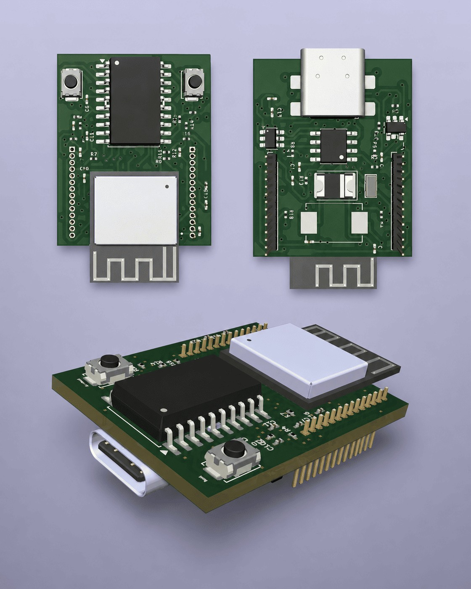

# ATtiny Microcontroller Board

[← All projects](../README.md#attiny-board) · [Profile](../../README.md#projects-to-start-with)

**Status:** Ongoing

Prepared the schematic and PCB layout for the microcontroller, voltage regulation, reset, clock and headers.

## Problem

Create a compact ATtiny board with USB-C input, regulation, programming and expansion connections.

## My contribution

Developed the current schematic and board layout.

## Validation and result

Final checks and manufacturing files are still pending.

## Tools

ATtiny · USB-C · Voltage regulation · PCB layout · Ongoing

## Explore the work

- [KiCad design files](https://github.com/moizZM/PCB-Design-Work/tree/main/ATtiny%20Microcontroller%20Board)
- [Public PCB design report (PDF)](https://github.com/moizZM/PCB-Design-Work/blob/main/PCB_Desing_Projects.pdf)

---

[← Return to this project in the portfolio](../README.md#attiny-board)
