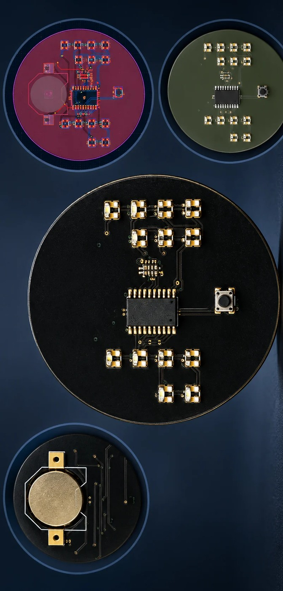

# Binary Watch PCB

[← All projects](../README.md#binary-watch) · [Profile](../../README.md#projects-to-start-with)

**Status:** Manufactured

Designed the schematic and compact board layout with careful LED and component placement.

## Problem

Fit a microcontroller, LEDs and battery-related circuitry into a compact wearable-style PCB.

## My contribution

Designed the schematic and compact PCB layout, selected and placed components, completed ERC and DRC, and prepared manufacturing outputs.

## Validation and result

A physical PCB was manufactured through JLCPCB.

## Tools

KiCad · Wearable PCB · LEDs · Compact layout · JLCPCB

## Explore the work

- [KiCad files and schematic PDF](https://github.com/moizZM/PCB-Design-Work/tree/main/Binary%20Watch)
- [Public PCB design report (PDF)](https://github.com/moizZM/PCB-Design-Work/blob/main/PCB_Desing_Projects.pdf)

---

[← Return to this project in the portfolio](../README.md#binary-watch)
