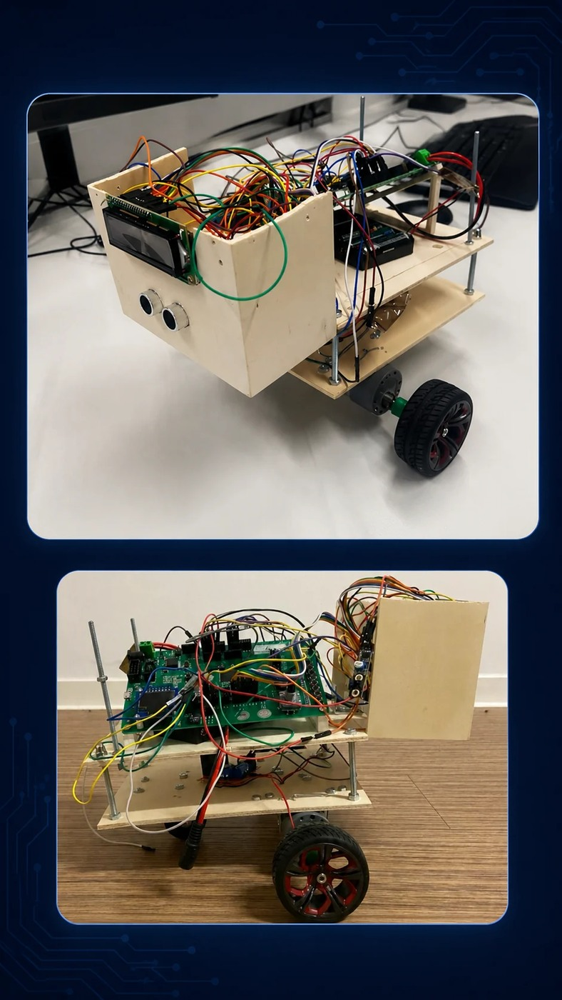

# Bluetooth Controlled Autonomous Robot

[← All projects](../README.md#bluetooth-robot) · [Profile](../../README.md#projects-to-start-with)

**Status:** Completed

A microcontroller based mobile robot developed during my third semester. The robot used an AVR128A microcontroller, ultrasonic and IR sensors, an HC-05 Bluetooth module, an L298N motor driver, DC motors and a 16x2 LCD.

## Project overview

A microcontroller based mobile robot developed during my third semester. The robot used an AVR128A microcontroller, ultrasonic and IR sensors, an HC-05 Bluetooth module, an L298N motor driver, DC motors and a 16x2 LCD. It could move forward, detect obstacles, change direction and respond to Bluetooth commands

## Problem

Build a small autonomous robot that could detect obstacles, avoid them automatically, and also allow wireless control through Bluetooth.

## My contribution

Worked on the DC motors, motor driver and LCD display. Helped build the mechanical structure and wiring. Used GPIO for sensor and LCD control, worked with timers and interrupts for sensor handling, and helped combine the different code sections into one working robot system.

## Validation and result

The completed robot could move forward, detect an obstacle using its sensors, turn to avoid it and stop when a Bluetooth command was received. The project demonstrated that the motor control, sensors, Bluetooth communication and display could work together as one embedded system.

## Tools

AVR128A Microcontroller · C Programming · USART · GPIO · Timers · Interrupts · Motor Control · Sensor Integration · Robot Wiring · Embedded Systems

## Discuss this project

[Contact me](mailto:moizzaheermalik@gmail.com) to discuss the engineering work or request available supporting material.

---

[← Return to this project in the portfolio](../README.md#bluetooth-robot)
