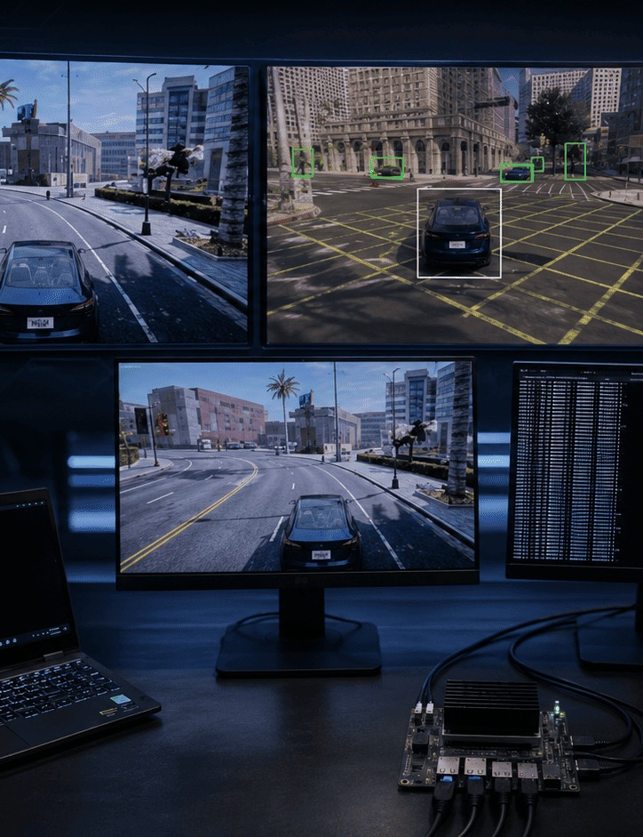

# CARLA & RISC-V UDP Controller Testbed

[← All projects](../README.md#carla-riscv) · [Profile](../../README.md#projects-to-start-with)

**Status:** Completed research work

CARLA generated vehicle telemetry while a RISC-V Ubuntu virtual machine acted as a virtual embedded controller using UDP and JSON.

## Problem

Test virtual automotive controllers under realistic communication faults and changing driving scenarios.

## My contribution

Supported traffic-light, pedestrian, ACC and CACC scenarios plus dropped, delayed, modified and stale messages.

## Validation and result

Used supervisory monitoring and CSV/JSON logs to inspect controller and communication behaviour.

## Tools

CARLA · RISC-V · QEMU · Ubuntu · Python · UDP · Fault injection

## Discuss this project

[Contact me](mailto:moizzaheermalik@gmail.com) to discuss the engineering work or request available supporting material.

---

[← Return to this project in the portfolio](../README.md#carla-riscv)
