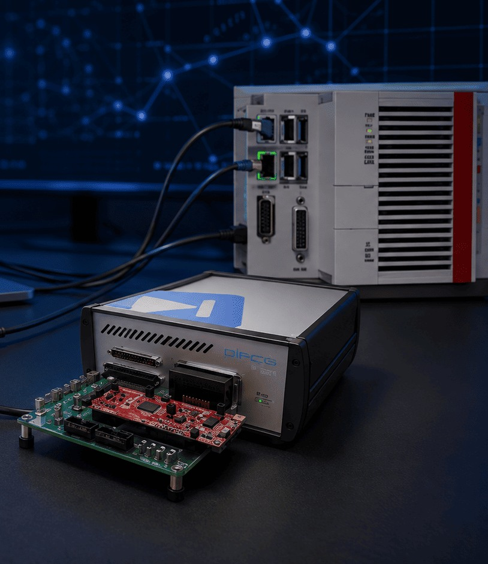

# EtherCAT Slave & HIL Verification for Power Stage Control

[← All projects](../README.md#ethercat-hil) · [Profile](../../README.md#projects-to-start-with)

**Status:** Completed

Developed an EtherCAT slave on TI C2000 with TwinCAT 3. Verified digital and analogue feedback through PLECS and RT Box test setups.

## Project overview

Developed EtherCAT slave functionality on a TI C2000 F28P65x and connected it to TwinCAT 3 and a PLECS RT Box plant.

## Problem

Create reliable real-time communication between an embedded controller and a power-stage validation environment.

## My contribution

Configured PDOs, object-dictionary and ESI data; integrated firmware, GPIO, PWM, ADC and PLECS-generated control code; debugged communication and timing issues.

## Validation and result

Tested cyclic PDO exchange, LEDs, digital and analogue feedback, PWM and ADC behaviour using TwinCAT Scope and PicoScope.

## Tools

TI C2000 · EtherCAT · TwinCAT 3 · Beckhoff SSC · PLECS · RT Box · HIL

## Discuss this project

[Contact me](mailto:moizzaheermalik@gmail.com) to discuss the engineering work or request available supporting material.

---

[← Return to this project in the portfolio](../README.md#ethercat-hil)
