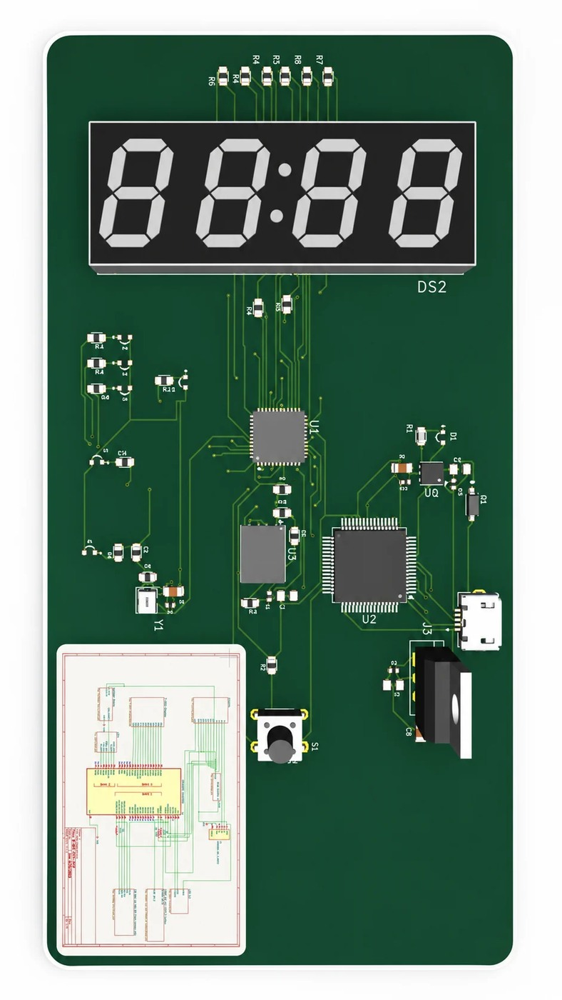

# Custom FPGA Development Board for an 8-Bit Harvard CPU

[← All projects](../README.md#fpga-board) · [Profile](../../README.md#projects-to-start-with)

**Status:** Completed university project

Designed a development board with USB, UART, SPI flash, voltage regulation, clock, reset, LEDs and a four-digit seven-segment display.

## Problem

Create a custom hardware platform around a Lattice iCE40UP5K FPGA.

## My contribution

Owned the PCB design: hierarchical schematics, component selection, layout, manual routing, ERC, DRC and manufacturing files. Teammates developed the CPU logic in VHDL.

## Validation and result

Completed ERC and DRC checks and prepared Gerber and drill outputs. This result describes design and manufacturing preparation; physical board testing is not claimed here.

## Tools

KiCad · iCE40UP5K · USB · UART · SPI · PCB layout

## Discuss this project

[Contact me](mailto:moizzaheermalik@gmail.com) to discuss the engineering work or request available supporting material.

---

[← Return to this project in the portfolio](../README.md#fpga-board)
