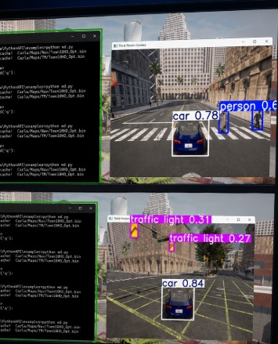

# Jetson Nano Object Detection & Monitoring

[← All projects](../README.md#jetson-research) · [Profile](../../README.md#projects-to-start-with)

**Status:** Research contribution

Worked with Jetson Nano, YOLOv5, TensorRT, video streaming and performance monitoring.

## Problem

Support real-time object-detection and performance-monitoring work in a research test environment.

## My contribution

Supported integration and validation activities proportional to my student-assistant role.

## Validation and result

Used monitoring information to inspect system performance during testing.

## Tools

Jetson Nano · YOLOv5 · TensorRT · Video streaming · Monitoring

## Discuss this project

[Contact me](mailto:moizzaheermalik@gmail.com) to discuss the engineering work or request available supporting material.

---

[← Return to this project in the portfolio](../README.md#jetson-research)
