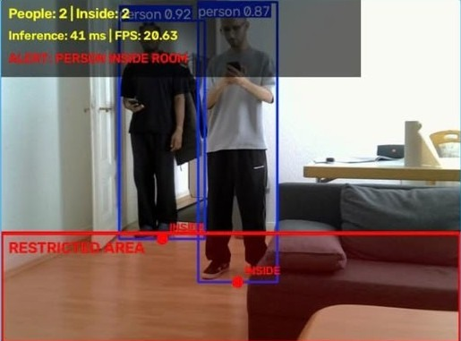

# Jetson Nano Restricted Area Monitor

[← All projects](../README.md#restricted-area-monitor) · [Profile](../../README.md#projects-to-start-with)

**Status:** In Progress

Jetson based system that detects restricted area entry, triggers alerts, and updates a live Node RED dashboard.

## Project overview

An edge monitoring prototype on an NVIDIA Jetson Nano 2GB. A USB camera and YOLO person detection feed restricted-zone logic, a browser camera view and a Node-RED Dashboard 2 interface.

## Problem

Traditional person detection alone cannot determine whether a detected person has actually entered a restricted zone. The challenge is to build a real time system that can identify the crossing of a defined boundary, distinguish total visible people from people inside the restricted area, and provide reliable alerts and evidence on an embedded edge device.

## My contribution

System integration, restricted zone logic, Node RED dashboard, testing, troubleshooting, and documentation.

## How it works

The bottom-centre of each detected person box is checked against a defined polygon. Entry is confirmed across consecutive frames. Total visible people and people inside the zone are counted separately. HTTP/JSON updates the dashboard; new alert events save JPEG evidence and CSV records.

## Validation and result

Tested with single and multiple people. The system correctly detected entry, updated counts, triggered alerts, and saved evidence.

## Tools

NVIDIA Jetson Nano 2GB · USB camera · YOLO26n · Python and OpenCV · Node RED Dashboard 2 · HTTP and JSON · JPEG and CSV event logging

## Discuss this project

[Contact me](mailto:moizzaheermalik@gmail.com) to discuss the engineering work or request available supporting material.

---

[← Return to this project in the portfolio](../README.md#restricted-area-monitor)
