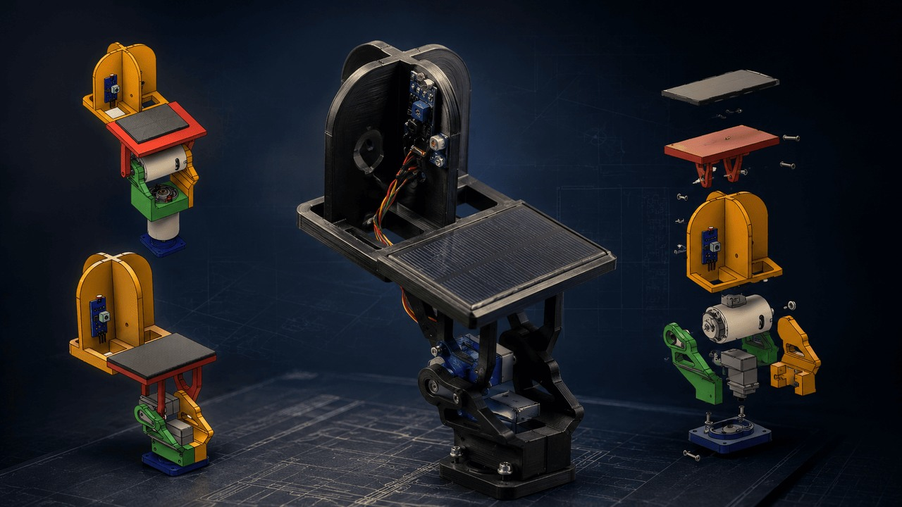

# Solar Tracking IoT System

[← All projects](../README.md#solar-tracker) · [Profile](../../README.md#projects-to-start-with)

**Status:** Completed university project

LDR sensors and an Arduino controlled a servo while a Raspberry Pi acted as an MQTT broker.

## Problem

Automatically orient solar panels towards the strongest detected light direction.

## My contribution

Built the Arduino logic and hardware setup, installed Mosquitto and supported assembly.

## Validation and result

The prototype changed panel orientation from sensor data and accepted remote MQTT commands.

## Tools

Arduino · Raspberry Pi · LDR · Servo · MQTT · Python · Fusion 360

## Discuss this project

[Contact me](mailto:moizzaheermalik@gmail.com) to discuss the engineering work or request available supporting material.

---

[← Return to this project in the portfolio](../README.md#solar-tracker)
