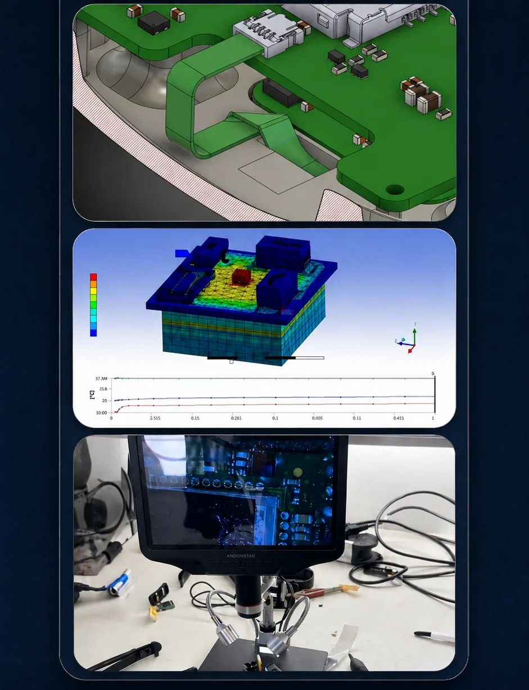

# Internship at microsynetics

[← All projects](../README.md#wearable-hardware) · [Profile](../../README.md#projects-to-start-with)

**Status:** Completed

Supported smart wearable testing, PCB debugging and prototype development at microsynetics. Combined laboratory work with CAD, component research and documentation.

## Project overview

Engineering work completed during my internship and later working student role in the Embedded Hardware Department at microsynetics GmbH. The work was connected to a smart emergency wristband and covered mechanical design, PCB support, component research, thermal simulation, prototype testing, hardware debugging, cellular module testing and technical documentation.

## Problem

Support the development and improvement of a compact smart wearable product by solving practical mechanical, electronic, testing and hardware integration problems.

## My contribution

Worked across several parts of embedded hardware product development. Designed and modified mechanical parts, supported PCB and component work, researched connectors and sensors, performed thermal simulations, helped with prototype sealing checks, inspected and debugged PCBs, supported soldering and hardware rework, tested cellular modules and prepared technical documentation.

## Validation and result

Used CAD fit checks, 3D printed prototypes, thermal simulations and laboratory measurements to check the hardware. Compared working and faulty PCBs, performed continuity and voltage checks, inspected signals with oscilloscopes and supported step by step hardware debugging. The work provided practical experience with complete embedded hardware product development.

## Tools

Fusion 360 · ANSYS Workbench · 3D Printing · PCB Inspection · PCB Debugging · Soldering & Rework · Component Research · Datasheet Analysis · Mechanical Fit Checks · Thermal Simulation · LEXI R10 · Excel VBA · LightBurn · Antenna Integration

## Discuss this project

[Contact me](mailto:moizzaheermalik@gmail.com) to discuss the engineering work or request available supporting material.

---

[← Return to this project in the portfolio](../README.md#wearable-hardware)
